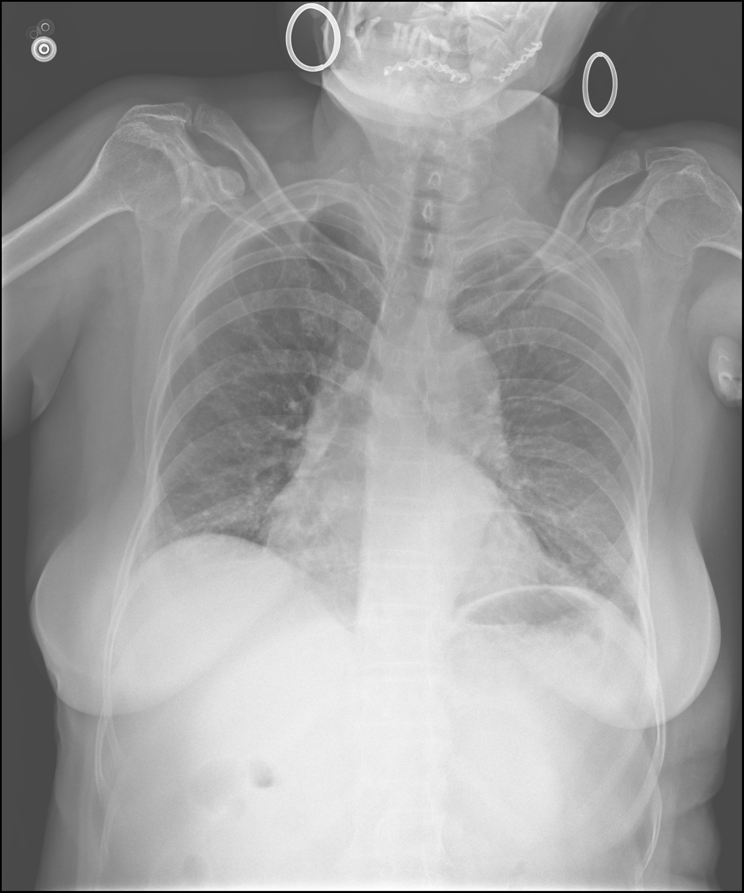
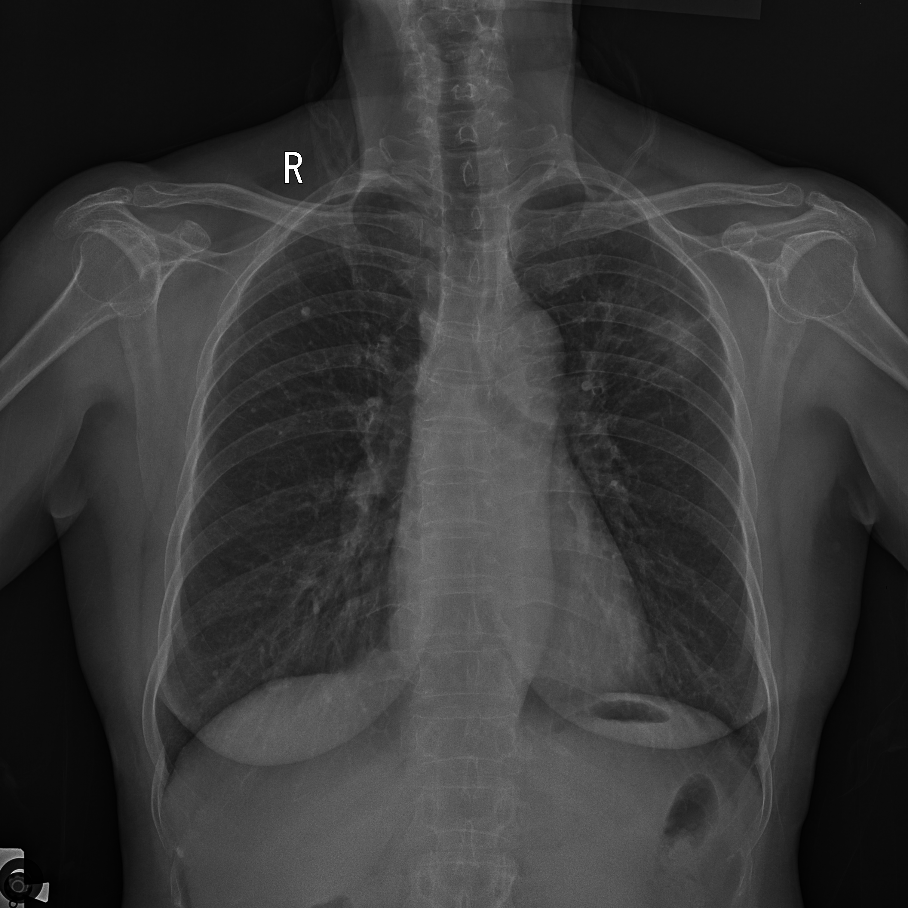
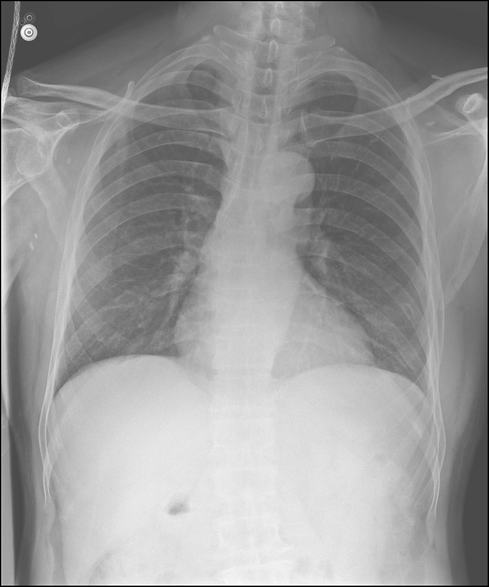

# Mẫu dataset VNMedical_bv175

Ba mẫu đầu tiên từ split `train`. Mỗi ảnh được lưu riêng; metadata và báo cáo nằm trong `samples.json`.

## Mẫu 1

- Tuổi: 62
- Giới tính: Nữ
- Tư thế: PA

**Findings**

- Phổi hai bên kém sáng, mờ kính rải rác, rốn phổi tăng đậm nhẹ.
- Bờ vòm hoành hai bên đều, hai góc sườn hoành nhọn.
- Bóng mờ tim không to, các cung tim trong giới hạn sinh lý.

**Impressions**

- Hình ảnh nghĩ nhiều đến tổn thương phổi kẽ.

## Mẫu 2

- Tuổi: 69
- Giới tính: Nữ
- Tư thế: PA

**Findings**

- Phổi hai bên kém sáng, đám mờ không đều thùy trên phổi trái, vài nốt vôi hóa nhỏ kèm xơ hóa vùng đỉnh phổi hai bên, rốn phổi tăng đậm nhẹ.
- Bờ vòm hoành hai bên đều, hai góc sườn hoành nhọn.
- Bóng mờ tim không to, các cung tim trong giới hạn sinh lý.

**Impressions**

- Hình ảnh đám mờ không đều thùy trên phổi trái.
- vài nốt vôi hóa nhỏ kèm xơ hóa vùng đỉnh phổi hai bên.

## Mẫu 3

- Tuổi: 61
- Giới tính: Nam
- Tư thế: PA

**Findings**

- Lồng ngực cân đối không thấy bất thường xương
- Dày tổ chức kẽ kèm mờ kính rải rác hai phổi
- Bờ vòm hoành hai bên đều. Góc sườn hoành hai bên nhọn
- Bóng tim không to. Các bờ trung thất trong giới hạn bình thường.

**Impressions**

- Hình ảnh tổn thương phổi kẽ.
